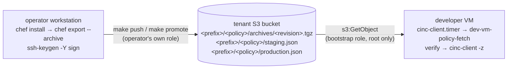

# Serverless policy delivery — signed Policyfile archives in S3, no CINC server

> Design record, written before implementation and revised after an
> architecture review the same day. Nothing here has been measured on a VM yet;
> every item under *To measure* is a gate on the release, not a fact.

**Date:** 2026-10-15
**Status:** design, direction approved; revised after review
**Ships as:** `v2.0.0` + `base-2.0.0`, a breaking pair, tagged together. `1.x` is frozen.

## The request

Tenants want hardened developer VMs on AWS without having to stand up and run
a CINC server. Today a tenant runs two Terraform roots. `vms/` holds the
developer fleet. `infra/` holds one EC2 instance whose only job is to be the
CINC server; an Ansible role configures it, and it holds a validator key that
every VM's bootstrap role can read from SSM.

The server earns very little of what it costs. The cookbook uses no feature
that needs one: there is no `search()`, no data bags, no chef-vault, and no
`node.save`. Nor does it set `node.normal` or `node.set` attributes, so
nothing relies on node state persisting between runs. Both were checked by
grep across `cinc/cookbooks/base` on 2026-10-15.

All the server does is hand each VM the policy revision its group points at.
That job is a file download, and S3 already does file downloads.

## Decisions

1. **The CINC server is removed, not made optional.** There is one delivery
   path. Two modes would double the bootstrap, the IAM grants, the boundary,
   the tenant Makefile and the docs, and every trap in CLAUDE.md would need
   checking twice.
2. **Policies travel as `chef export --archive` tarballs in an S3 bucket the
   tenant owns.** The VM runs `cinc-client` in local mode against the archive.
   The Policyfile, the lock, `pin-check`, the cookbook tag stream and the
   staging → production promotion all stay.
3. **The bucket is bring-your-own.** The module takes the bucket name, owner
   account, region and prefix, and never creates the bucket. It can be in the
   same account or another one, and encrypted with SSE-S3 or SSE-KMS.
4. **Every pointer to a revision is signed, and the VM verifies it before it
   converges.** See *Why signing is mandatory*.
5. **Access is by IAM role only.** The VM reads with its instance profile; the
   operator writes with their own role. There are no static keys, no
   validator and no `client.pem`.
6. **`1.x` is frozen.** `v1.1.0` and `base-1.2.1` remain the last
   server-based releases and stay usable, because tags are immutable. Nothing
   is backported, and there is no migration path: a tenant moves to `2.x` by
   recreating its VMs.
7. **A blind fleet is acceptable.** With `log_shipping = false` and no server,
   nothing central knows which revision a VM runs, whether it rejected an
   envelope, or whether it is frozen. This follows from the tenant choosing to
   ship no logs; the runbook says how to check a single VM by hand.
8. **The delivery script ships with the module, not only with the cookbook.**
   The script that verifies a converge cannot be delivered only by that same
   converge. See *The delivery script*.

## How it works



### Object layout

```text
s3://<bucket>/<prefix>/<policy_name>/archives/<revision_id>.tgz   content-addressed, written once
s3://<bucket>/<prefix>/<policy_name>/staging.json                 signed envelope
s3://<bucket>/<prefix>/<policy_name>/production.json              signed envelope
```

Archives are named by the lock's `revision_id` and are never overwritten.
Promotion does not copy an archive: it writes a new `production.json` that
names a revision staging already carries. Each policyfile has its own
envelopes, so a tenant with several policies can still end up partially
promoted, exactly as `make promote` can today
(`tenant-skeleton/cinc/Makefile:100`).

### The envelope

A group's pointer is **one object** holding both the manifest and its
signature:

```json
{
  "manifest": "<base64 of the manifest bytes>",
  "signature": "<ssh-keygen -Y sign armoured output>"
}
```

The manifest it carries:

```json
{
  "format": 1,
  "fleet_id": "<bucket>/<prefix>",
  "policy_name": "dev-vm",
  "policy_group": "production",
  "revision_id": "<lock revision_id>",
  "archive_sha256": "<sha256 of the stored .tgz>",
  "cookbook_tag": "base-2.0.0",
  "signers_sha256": "<sha256 of the canonical signers set this revision installs>",
  "serial": 1760524800
}
```

**Why one object.** S3 replaces a single object atomically, but two objects
can be read either side of a write. Splitting the manifest and its signature
would make every push that lands inside a timer window a spurious failure.

**Verification order.** The verifier checks the signature over the decoded
manifest bytes first and parses them only after that. It never fetches the
envelope a second time between verifying and acting on it.

**Signature namespaces bind the group.** A staging envelope is signed with
`-n dev-vm-policy-staging` and a production envelope with
`-n dev-vm-policy-production`. Each line in the signers file says which
namespaces that key may sign (`namespaces="…"`). So a key that may only sign
staging, for example a CI key, cannot publish to production. A staging
signature also never verifies as production, even if the envelope is copied
across, and this holds independently of the `policy_group` field.

**`fleet_id` binds the bucket.** A person who signs for several tenants
produces envelopes that are valid only for the fleet they were made for.

**`serial`** orders envelopes within a group. Its rules are under
*Rollback and serial*.

### Operator side — the tenant `cinc/Makefile`

**`make push`**

1. `make -C .. pin-check`. As before; it now also refuses a `base-1.*` pin,
   since a `1.x` cookbook on a `2.x` VM rewrites the unit back to a server
   client and the fleet stops converging.
2. `chef install` from the lock. The no-`chef update` rule on the push path
   stays.
3. `chef export <policyfile> <tmpdir> --archive`.
4. Upload the archive to `archives/<revision_id>.tgz` with `--if-none-match '*'`.
   If the object already exists, the upload is skipped. In both cases, the
   script **downloads the stored object and hashes those bytes**.
   `chef export` is not reproducible, because tar mtimes and the gzip header
   vary, so a hash of a fresh local export would not match an archive pushed
   earlier. It also must not trust an existing object blindly: the hash of the
   stored bytes is what the envelope commits to, and the VM checks it.
   So before hashing, the script compares the stored archive's **contents**
   with the fresh export: the same paths, types, file contents and link
   targets, read with `tarfile` and never extracted. A hash alone would sign
   whatever is there. `revision_id` is in the committed lock, so anyone who
   can write the bucket, with no signing key, can store
   `archives/<revision_id>.tgz` first, with the genuine lock inside and a
   recipe of their own, and the next push would sign it. A mismatch stops the
   push.
5. Read the current `staging.json`, if one exists. Keep its ETag, and verify
   it (a forged envelope must not raise the serial; see below).
6. Build the manifest: `serial = max(now, current_serial + 1)`, and
   `signers_sha256` computed from the policyfile's signers attribute. Refuse
   if the operator's own signing key is not in that attribute with the
   staging namespace. Otherwise the revision would install a trust set that
   rejects its own signer's next push.
7. Sign with `ssh-keygen -Y sign -n dev-vm-policy-staging`. The key can be on
   disk, in the agent, or on a hardware token.
8. Write `staging.json` with `--if-match <etag>` (or `--if-none-match '*'`
   for the first push). If two operators push at once, one fails loudly
   rather than silently replacing the other's work.

**`make promote`**

1. `make preflight`, then `pin-check`, as today.
2. Fetch `staging.json`, verify its signature locally against the tenant's
   signers set (from `terraform console` on `var.policy_signers`), and require
   `revision_id` to equal the committed lock's. This replaces the
   `knife raw /policy_groups/staging` gate and keeps its meaning: promotion
   refuses content that staging is not carrying. It then re-runs push's
   archive check: the stored archive must hash to staging's `archive_sha256`
   **and** hold what the lock exports. Without the second half, a stolen
   staging-only key could re-sign staging over a doctored archive with the
   right `revision_id`, and the operator's production key would carry it into
   production. `policy-publish.sh staged` runs these checks alone, for every
   policy, before the prompt.
3. Show the same confirmation prompt as today, with the same caveat that this
   does not prove any VM converged.
4. Read `production.json` and its ETag. Build a new manifest with
   `policy_group = "production"`, the same `revision_id` and
   `archive_sha256`, and a `serial` computed by the same rule. Sign it with
   the production namespace and write it with `--if-match`.

**Removed:** `make node-delete` (there is nothing to deregister),
`cinc/.chef/knife.rb`, and `admin.pem`.

**Workstation needs:** Chef Workstation, as today, plus the AWS CLI and
OpenSSH ≥ 8.1.

### VM side

#### The delivery script

`dev-vm-policy-fetch` lives in **one place in the source**:
`vms/modules/ec2/files/dev-vm-policy-fetch`.

`user_data` embeds it with `file()` and installs it at first boot. The
cookbook carries a byte-identical copy at
`cinc/cookbooks/base/files/default/dev-vm-policy-fetch`, so a fix can reach
running VMs. `boundary-check` keeps the module from reading `cinc/`, so the
two copies are kept equal by a test instead. `test/test-fetch-sync.sh` runs
in **both** release gates and in CI, and fails on any difference.

The cookbook never replaces the script it is running under in place.
`base::cinc_client` installs a new version as `dev-vm-policy-fetch.new`, runs
`--self-test` against it, then moves it into place, keeping the previous
version as `.prev`. `--self-test` checks:

- the syntax;
- one full run of the new script — fetch, verify, extract, converge — against a
  signed fixture the cookbook ships (`files/default/policy-fetch-selftest/`,
  generated by `test/make-policy-fetch-fixture.sh`), with stub `aws` and
  `cinc-client` and throwaway state. A missing tool fails it too.

The unit's `ExecStart` is a small launcher, `dev-vm-policy-run`. Only
`user_data` writes it; the cookbook never does. The launcher runs the script,
and only if the script **cannot run at all** — exit 126/127 (not executable,
not found) or 2 (a bash syntax error) — runs `.prev` instead. This gives the
script the same protection the `-` prefix already gives `cinc-client-upgrade`
(`cinc-client-upgrade.erb:14-17`).

The fallback is deliberately narrow. Every other exit code, the script's
own 70 included, can be caused from outside the script, for example by
filling the disk. If the launcher fell back on those, whoever caused one
could downgrade the VM to a `.prev` whose bug the current version fixed.
Runtime bugs are what `--self-test` exists to catch, before a version is
installed at all.

#### One run, in order

All downloads go to `/run/dev-vm/` (`root:root 0700`), never `/tmp`.

1. **Read `/etc/dev-vm/policy.conf`.** `user_data` writes it at first boot
   and it never changes. It holds:
   - the bucket, its owner account and its region;
   - the prefix and `fleet_id`;
   - the policy name and group;
   - `node_name`, which is the `Name` tag.
2. **Fetch `<group>.json`** with the bootstrap role, through IMDS. Only root
   can reach IMDS (`base::imds`). Every `aws s3` call passes
   `--expected-bucket-owner` and `--region`. A transient error is retried
   with backoff inside the run.
3. **Verify the signature:**
   `ssh-keygen -Y find-principals -s sig -f /etc/dev-vm/policy-signers`, then
   `ssh-keygen -Y verify -f /etc/dev-vm/policy-signers -I <principal> -n dev-vm-policy-<group> -s sig < manifest`,
   repeated for each principal returned. The namespace is fixed per group, so
   a signature made for any other purpose does not verify.
4. **Check the manifest:**
   - `fleet_id`, `policy_name` and `policy_group` equal the VM's own;
   - `revision_id` matches `^[0-9a-f]{64}$`, since it ends up in paths;
   - the serial rules below hold.
5. **Get the archive.** Fetch `archives/<revision_id>.tgz` unless it is
   already cached, and **re-check its sha256 on every use, cached or not**.
6. **Extract** into a new temporary directory under
   `/var/lib/dev-vm/policy/` (`root:root 0700`):
   - `tar --no-same-owner --no-same-permissions`;
   - refuse any member with an absolute path, `..`, a symlink or a hard link.
     The workstation's uid is often 1000, which is the developer's uid
     (CLAUDE.md trap 4), so ownership is never taken from the archive.
   - Check that the extracted `Policyfile.lock.json` carries the manifest's
     `revision_id`, then rename the directory into place.

   A crash mid-extract leaves only a temporary directory, which the next run
   deletes.
7. **Run `cinc-client -z`** against the extracted tree with a client config
   the script writes:
   - `local_mode`, `use_policyfile`, `policy_document_native_api`;
   - `node_name` from `policy.conf`;
   - node state and cache inside that same tree.

   The extraction is new on every run, so node state does not carry over
   between runs. That is safe because nothing in `base` relies on it.
   `node.name` must equal the `Name` tag. `alloy.rb:314` and
   `aws_access.rb:81` pass it on: as the Loki `instance` label (which the
   alerts group by) and as `VM_NAME`, the key for the per-VM SSM access
   parameter. Local mode would default the name to the hostname instead.
8. **On success**, record the serial, point `current` at this revision, and
   delete cached revisions other than `current` and the one before it.

`cinc-client-upgrade` stays as `ExecStartPre=-`, unchanged. Its version pin is
inside the signed cookbook, so it moves only by signed revisions.

The unit sets `SyslogIdentifier=cinc-client`. The *Errors and warnings* log
panel filters on `syslog_identifier=~"alloy|cinc-client"`
(`grafana/dashboards/dev-vm-audit.json:1428`), and without this setting the
new `ExecStart` would drop out of it. The *converge failed* alert
(`grafana/alerts/dev-vm-security.yaml:223-224`) and the two stat panels that
count failures match systemd's own `cinc-client.service: Failed with result`
line at `uid="0"`, which a change to `ExecStart` does not affect.

#### When a step fails

| Failure | Behaviour |
|---|---|
| Bucket unreachable or envelope missing, after retries | Converge `current`; fail the unit only once this has happened on 3 runs in a row (about 1.5 h). A single S3 5xx must not trigger a `for: 0s` alert |
| Signature invalid; fleet, name or group mismatch; serial rule broken; sha mismatch; unsafe archive member | Log the reason, converge `current`, fail the unit immediately |
| Script cannot run (126, 127, 2) | The launcher runs `.prev` |
| Script internal error (70): bad config, missing tool, full disk | Fail the unit; no fallback |
| No `current` yet (first boot) | Fail; `user_data` fails closed as today |
| Converge fails | Fail the unit, as today |

On a delivery failure the VM still converges its last good revision, so drift
correction keeps running while the bucket is down or under attack. Failing
the unit is what triggers the existing *converge failed* alert, so a rejection
is never silent unless the tenant ships no logs (decision 7). In that case the
runbook's single-VM check is `systemctl status cinc-client`, plus the last
line of `/var/lib/dev-vm/policy/status`, which the script writes on every run.

### Rollback and serial

`serial` is a Unix timestamp that only ever goes up. The VM keeps the last one
it applied in `/var/lib/dev-vm/policy/last-serial`. It accepts an envelope
only when all of these hold:

- `serial > last` — a newer envelope; or
- `serial == last` **and** both `revision_id` and `archive_sha256` equal what
  is applied (the same revision converging again). A different revision with
  an equal serial is rejected;
- **and** `serial <= now + 24h`. The VM's clock is kept by `base::chrony`;
- **and** `serial >= POLICY_MIN_SERIAL`, from `var.policy_min_serial`
  (default 0). This applies on every run, including first boot.

The upper bound matters. Without it, one mistaken or compromised signer could
publish a serial far in the future. Every VM would record it and then reject
every legitimate envelope after it, until the VMs were recreated. With the
bound, the worst a fast clock can do is hold the fleet back for a day.

The floor matters for new VMs. A new VM has no history to compare against,
and `signers_sha256` only refuses envelopes from before the latest signer
rotation. Without the floor, anyone who can write the bucket could serve a new
VM any older envelope signed since that rotation, including a revision whose
vulnerability was fixed later, and keep serving it. After a security fix, the
operator raises `policy_min_serial` to the fix's serial. From then on, nothing
older converges anywhere.

A **running** VM can still be held on its current revision by withholding new
envelopes. Nothing on the VM can detect that, and the design accepts it: see
*What signing does not protect against*.

**Break-glass recovery.** If a serial does get stuck, the fix is to delete
`/var/lib/dev-vm/policy/last-serial` as `admin`, which has root through EC2
Instance Connect. The runbook gives the procedure.

**An intentional rollback** is a new push of the old lock. It gets a new
serial, so rolling back is an ordinary push and never a replay.

### Bootstrap — `vms/modules/ec2/user_data.tf`

The first-boot window stays exactly as it is:

- the cloud-init sudo grant goes first;
- IMDS is blocked for every uid except root;
- any error fails closed;
- diagnosis goes through the serial console.

The bootstrap role still reads a secret: the Loki token, when shipping is on.
It also reads the per-VM access config (`iam.tf:89`). So the reasoning in
`user_data.tf:12-22` still holds; its comments are rewritten without the
validator.

What changes:

- The validator fetch, `/etc/cinc/validation.pem` and the `client.rb` server
  config are removed.
- A `PolicyGroup` tag that is neither `staging` nor `production` now
  **fails closed**. Today it quietly defaults to `production`
  (`user_data.tf:73-76`), which turns a mistyped staging VM into a production
  one.
- `user_data` writes `/etc/dev-vm/policy.conf` from the module inputs and the
  `Name`, `PolicyName` and `PolicyGroup` tags, reading the tags **once**,
  here. It also writes `/etc/dev-vm/policy-signers` from
  `var.policy_signers`, and installs the script and the launcher.
- The CINC `.deb` is downloaded into `/run/dev-vm/` instead of `/tmp/`. Today
  `sha256sum -c` and `dpkg -i` run on a file in `/tmp`, and a developer who
  is already logged in over SSH could swap it between the check and the
  install.
- The first converge is `dev-vm-policy-run`, the same command the timer runs,
  and it ends the same way: success or `bootstrap_failed`. Whenever there is
  no `last-serial` — at first boot, and after the break-glass procedure
  deletes it — the script makes one extra check: the manifest's
  `signers_sha256` must equal the hash of the VM's signers file, written by
  Terraform at first boot. With no serial history to compare against, any
  validly signed old envelope would otherwise pass. This check refuses an
  envelope from before the latest signer rotation, and that is exactly what a
  stale `var.policy_signers` would accept.

Tags are never read again after first boot. The comment at the top of
`cinc_client.rb` says they are re-read every run, which is wrong today; fix it
in passing. Re-reading them would let anyone with `ec2:CreateTags` move a VM
between groups, and the identity boundary does not deny that action.

## Trust: who decides which keys a VM accepts

The signers file has two sources, one after the other:

1. **At first boot**, it comes from `var.policy_signers` via `user_data`.
   Nothing is verified yet at that point, so the first trust set has to come
   from outside the policy.
2. **On every converge after that**, it comes from
   `default['base']['policy']['signers']` in the tenant policyfile, which
   `base::cinc_client` writes.

The recipe refuses to install a new set, and fails the converge, in any of
these cases:

- the set is empty;
- a line does not match
  `<principal> namespaces="<list>"[,valid-before="…"] <ssh-ed25519|sk-ssh-ed25519@openssh.com> <key>`.
  `cert-authority` lines are refused, because they would make every key
  signed by that CA trusted;
- the set does not include the key that verified the envelope now being
  converged. Without this check, a typo locks the fleet out for good.

The same line format is checked by a Terraform `validation` on
`var.policy_signers`.

**Rotating a key** is done by ordinary signed pushes:

1. Push a revision that adds the new key, signed with the old one.
2. Update `var.policy_signers`.
3. Push a revision that drops the old key, signed with the new one.

`make preflight` requires `var.policy_signers` to equal the signers set in
production. During a rotation they briefly differ, and preflight says so.
Any VM created in that window fails closed through the `signers_sha256` check,
and that is the safe outcome.

**What signing does not protect against.** All production signers are equal
roots. A signed revision can replace the trust set, so a rotation and a
takeover cannot be told apart from the VM's side. If a key is compromised,
its holder can keep publishing envelopes that re-add it until every VM has
converged the revocation. A VM that Idlefy has stopped picks the revocation
up when it starts again.

The mitigations are limited:

- keep production signers few;
- keep CI on a key that has only the staging namespace;
- use `valid-before` where you can.

Revoking a key is a race, and this design accepts that.

### Why signing is mandatory

The identity boundary binds only the roles this module creates. A
bring-your-own bucket can have other writers in the tenant's account, such as
CI roles, admins and replication sources. Anyone who can write an unsigned
pointer becomes root on every VM in the fleet at its next timer tick. No IAM
control in this repository can rule that out, so the trust root has to be
something only the operator holds: a key.

## IAM

### Bootstrap role (the instance profile)

- **Removed:** `ssm:GetParameter` on the validator parameter.
- **Added:** `s3:GetObject` on
  `arn:aws:s3:::<bucket>/<prefix>/<policy_name>/*` for each `policy_name` the
  module's instances use.
  - There is no `s3:ListBucket`, because the script fetches exact keys. As a
    result a missing object returns 403, not 404, and the script's messages
    say "missing or denied".
  - `policy_name` now has a validation, `^[a-z0-9][a-z0-9-]{0,62}$`. It is
    interpolated into this ARN, and a `*` or `?` would widen the grant
    (`variables.tf:37` has no validation today).
- **Added, only when `policy_kms_key_arn` is set:** `kms:Decrypt` on that key.
  The key policy must also allow it, and the runbook gives that statement.

**Cross-account bucket.** The owning account adds a bucket policy statement
whose `Principal` is the tenant's account root, conditioned on
`aws:PrincipalArn` `StringLike` `arn:aws:iam::<tenant>:role/dev-vm-boot-*`.
A role ARN in `Principal` cannot contain a wildcard. The module cannot write
this policy, so the runbook gives the statement. `make preflight` cannot read
it from the tenant account, so it reminds the operator rather than checking;
the first staging VM is the real test.

**What the bucket must allow.** The VMs sit in public subnets, so a bucket
policy that only allows access through a VPC endpoint locks them out. That
setup is unsupported. The bucket's region must also be in the tenant's SCP
region allowlist, which preflight checks.

### Identity boundary — new deny entries

Signing means a bucket writer cannot change **what** a VM converges to. A
bucket writer can still stop updates or delete history. That is trap 1 again:
the deny has to cover every route to the asset, not just the obvious API.

These entries only matter when a bundle declares `s3` or `kms`. Without that,
the boundary's allow list already leaves those namespaces out. Each entry is
scoped to the policy bucket, so a developer's own S3 use elsewhere is not
affected.

| Route | Actions | Resource |
|---|---|---|
| Overwrite or delete objects. `CopyObject` and multipart uploads authorise as `PutObject` | `s3:PutObject`, `s3:DeleteObject`, `s3:DeleteObjectVersion` | `arn:aws:s3:::<bucket>/<prefix>/*` |
| Lock objects so the next push fails | `s3:PutObjectRetention`, `s3:PutObjectLegalHold`, `s3:BypassGovernanceRetention` | same |
| ACLs and tags on objects, where lifecycle or bucket policy rules match on tags | `s3:PutObjectAcl`, `s3:PutObjectVersionAcl`, `s3:PutObjectTagging`, `s3:PutObjectVersionTagging`, `s3:DeleteObjectTagging`, `s3:DeleteObjectVersionTagging` | same |
| Rewrite the bucket's own rules | `s3:PutBucketPolicy`, `s3:DeleteBucketPolicy`, `s3:PutBucketAcl`, `s3:PutBucketOwnershipControls`, `s3:PutBucketPublicAccessBlock` | `arn:aws:s3:::<bucket>` |
| Make objects disappear later, or make the next push fail | `s3:PutLifecycleConfiguration`, `s3:PutBucketVersioning`, `s3:PutBucketObjectLockConfiguration`, `s3:PutEncryptionConfiguration`, `s3:DeleteBucket` | same |
| Reach the bucket through a new route: S3 authorises an access point request against the **access point's** ARN, so a deny on the bucket ARN does not match it | `s3:CreateAccessPoint`, `s3:PutAccessPointPolicy`, `s3:CreateMultiRegionAccessPoint`, `s3:PutMultiRegionAccessPointPolicy`, `s3:CreateAccessGrantsInstance`, `s3:CreateAccessGrantsLocation`, `s3:CreateAccessGrant` | `*` |
| Make every VM's GET fail, or the objects unreadable | `s3:PutBucketRequestPayment`, `s3:PutIntelligentTieringConfiguration`, `s3:PutBucketTagging` (when the bucket policy reads tags) | `arn:aws:s3:::<bucket>` |
| Object Lambda access points, which are separate actions from ordinary access points | `s3:CreateAccessPointForObjectLambda`, `s3:PutAccessPointPolicyForObjectLambda` | `*` |
| Cut the subnet off from S3 (and Loki) without touching a route or an ACL: DNS off, other resolvers via DHCP, a gateway endpoint that adds its own routes and denies the bucket, Resolver rules | `ec2:ModifyVpcAttribute`, `ec2:AssociateDhcpOptions`, `ec2:CreateVpcEndpoint`, `ec2:ModifyVpcEndpoint`, `route53resolver:AssociateFirewallRuleGroup`, `route53resolver:AssociateResolverRule` | `*` |
| Take a peer's bootstrap role away (IMDS off) or a whole region's egress | `ec2:ModifyInstanceMetadataOptions`, `ec2:ModifyInstanceMetadataDefaults`, `ec2:ModifyVpcBlockPublicAccessOptions`, `account:DisableRegion`, `ec2:DeleteVpcEndpoints`, Resolver firewall rule and association updates | `*` |
| Take a peer's name, and an ACME certificate for it | `ec2:AssociateAddress`, `ec2:DisassociateAddress`, `ec2:ReleaseAddress`; `route53:ChangeResourceRecordSets` | `*`; the fleet's hosted zone |
| Batch Operations. Needs `iam:PassRole`, which `iam:*` denies; listed so nobody prunes it when `iam:*` is narrowed | `s3:CreateJob` | `*` |
| The SSE-KMS key, when one is set | `kms:ScheduleKeyDeletion`, `kms:DisableKey`, `kms:PutKeyPolicy`, `kms:CreateGrant`, `kms:RevokeGrant`, `kms:DeleteImportedKeyMaterial`, `kms:UpdateAlias`, `kms:TagResource`, `kms:UntagResource` | the key |

**Known gaps, documented rather than closed:**

- **Writes through access points that already exist.** A delegating access
  point created before the VM existed is outside this boundary's reach.
- **Replication into the bucket.** `s3:PutReplicationConfiguration` is
  checked against the **source** bucket, which can be the developer's own.
  `s3:ReplicateObject` is checked against the replication role, not the
  identity role. Neither can be stopped from here. The control is the policy
  bucket's own bucket policy, and the runbook recommends denying replication
  writes from any principal outside the tenant's operator roles.

The boundary is a managed policy, and IAM refuses one over 6,144 characters.
With a KMS key it is 4,173 today, after the third review pass replaced
single actions with families (`route53resolver:*`, `ec2:*VpcEndpoint*`,
`ec2:*InstanceMetadata*`, `ec2:*VpcBlockPublicAccess*`, `ec2:*Address`): a
wildcard covers siblings by construction and costs fewer characters. The test
checks denial semantically — is this action matched by some Deny pattern —
and also pins the reads no wildcard may swallow. `hardening.tftest.hcl` fails it above 4,644,
so 1,500 characters stay free for the Allow list a VM's bundles declare.
Every new deny entry spends that margin. The deny list is open-ended — two
review passes found eleven more routes after the first draft — so the control
that scales is the Allow list: declaring `ec2`, `s3`, `route53`, `kms` or
`account` in a bundle is a security review, not a configuration change.

That is now enforced, not just advised. Four review passes on 2026-10-15
kept finding routes the deny list missed, so `access_bundles` gained
`infrastructure_access` (default `false`). A bundle whose `allowed_actions`
names `ec2`, `ebs`, `s3`, `s3-object-lambda`, `kms`, `ssm`, `account`,
`route53`, `route53resolver`, `route53profiles`, `servicediscovery`,
`network-firewall`, `autoscaling`, `batch` or `imagebuilder` fails `plan`
unless the flag is set. The deny list stays as the second layer.
`route53:CreateHostedZone` is denied with no condition: a deny on
`route53:VPCs` would rest on a condition key no one here has verified for
that action.

If the bucket is shared with other data, the bucket-ARN rows deny those
configuration changes for the whole bucket. The runbook recommends a
dedicated bucket.

The existing SSM entries stay. `ssm:GetParameter*` still guards the Loki
token and `ssm:PutParameter` still guards its integrity. Their comments
(`iam.tf:166-171`, `:218`, `:228-234`) are rewritten around the Loki token
instead of the validator. `hardening.tftest.hcl` asserts each new entry and
its resource, with and without a bundle that declares `s3:*`.

## Confidentiality

Every VM can read every policy under the prefix. That is no worse than today,
when the validator could fetch any policy from the server.

The rule this depends on is now stated explicitly: **policyfile attributes are
not secret.** Anything secret lives in SSM and is fetched by a recipe at
converge time, as `base::alloy` already does with the Loki token. A reviewer
who sees a credential added as a policyfile attribute should reject it on
that basis.

## What is removed

The removal is the whole server and every place that names it.

**Terraform: module and tests**

- **`vms/modules/ec2` inputs** `cinc_server_url` and
  `cinc_ssm_parameter_name`; the validator grant (`iam.tf:87-91`); the
  validator block and `client.rb` in `user_data.tf`; the comment in
  `main.tf:130-139`.
- **`vms/modules/ec2/tests/`**: `hardening.tftest.hcl` (including the
  bootstrap-message assertions at `:75-81` and the grant at `:247-248`),
  `validation.tftest.hcl` and `unknown_bundle.tftest.hcl`. All of them set
  the two inputs.
- **`vms/modules/fleet-guards/main.tf:7-12`**: keep the guard but rewrite the
  reason. It used to be one CINC node per name; it is now the Loki `instance`
  label, the per-VM SSM parameter and the outputs.

**Tenant skeleton**

- **`tenant-skeleton/infra/`**: the whole tree — the CINC server, the
  `security-vm` module, the Ansible `cinc-server` role, `vault.yml.example`
  and `group_vars`.
- **`tenant-skeleton/vms/`**: `main.tf:78,82`, `variables.tf:20,46`,
  `tenant.auto.tfvars.example`, and `tests/skeleton.tftest.hcl`.
- **`tenant-skeleton/Makefile`**: from `TEMPLATES`, the `infra/*` entries and
  `cinc/.chef/knife.rb`. `test/test-prepare.sh` is updated to match.
- **`tenant-skeleton/cinc/`**: `.chef/knife.rb.example`; `node-delete`; and
  `knife raw` in `promote`.
- **`tenant-skeleton/.claude/skills/tenant-setup/SKILL.md`**: rewritten.
- **`tenant-skeleton/CLAUDE.md`**: hard rules 4 and 8; step 3 of *Delete a
  VM*; the *A test VM is not cleaned up* trap, which mentions `node-delete`;
  and the *Per-region secrets* table.

**Platform root**

- **Root `infra/`**, the reading copy, is deleted: nothing is left to read.
  The `infra/` paragraph in CLAUDE.md goes with it.
- **Root `cinc/Makefile`**: `KNIFE_CONFIG`, and `node-delete` in
  `DEPLOY_TARGETS` and `.PHONY`.
- **`.gitignore` and `tenant-skeleton/.gitignore`**: the server's entries
  (`knife.rb`, `admin.pem`, `vault.yml`, `.vault_pass`, the inventory) are
  **kept**, gathered in one "retired" block. A tenant that held the server may
  still have the files on disk, and a dropped entry would make a decrypted
  vault committable.

**Scripts and tests** (each script has a byte-identical copy in `scripts/` and
`tenant-skeleton/scripts/`, `test-skeleton-sync.sh:26`; both change together)

- **`preflight.sh`**: the validator-parameter check for each region and the
  `knife raw` comparison go. The new checks are listed below.
- **`add-region.sh`**: the validator step goes. The bucket is global, so a
  new region needs only its Loki token parameter. The printed "two secrets"
  text is rewritten.
- **`test/test-preflight.sh`**: drops the `knife` and validator shims.
- **`test/test-get-started-skill.sh`** and the root `get-started` skill.

**CLAUDE.md, docs and design records**

- **Root `CLAUDE.md`**: hard rule 3 (`vault.yml`) is deleted. Hard rule 4 and
  trap 6 keep the Loki token and drop the validator. Trap 1's validator
  examples are rewritten.
- **Docs**: `README.md`, `docs/index.md`, `docs/runbook.md`,
  `cinc/README.md` (including line 547's "edit client.rb") and
  `vms/README.md` are rewritten for the S3 flow.
- **Earlier design records**: `first-external-review.md`,
  `per-vm-aws-access.md`, `log-shipping.md` and `optional-log-shipping.md`
  each get a one-line "historical: predates serverless delivery" note. They
  are not rewritten.

## What is added

**Module `ec2` inputs.** Each one has a `validation`. They are a contract, so
they land in the same commit as the skeleton (hard rule 2).

| Input | Type | Notes |
|---|---|---|
| `policy_bucket` | `string` | Required; must have S3 bucket-name shape |
| `policy_bucket_owner` | `string` | Required; 12-digit account ID; passed as `--expected-bucket-owner` on every call, so a bucket deleted and re-created under the same name in another account is refused |
| `policy_bucket_region` | `string` | Required; may differ from the VM's region |
| `policy_prefix` | `string` | Default `"dev-vm-policies"`; no leading or trailing slash |
| `policy_kms_key_arn` | `string` | Default `null`; set for SSE-KMS only |
| `policy_signers` | `list(string)` | Required, not empty; one line per signer, in the signers-line format above |
| `policy_min_serial` | `number` | Default `0`; the lowest serial any VM accepts. Raise it after a security fix |

**The cookbook** gets `base::cinc_client` on local mode, the delivery-script
copy and its self-tested swap, the signers attribute with its guards, and
`SyslogIdentifier`. It also gets a guard: `base-2.x` refuses to converge on a
VM that has no `/etc/dev-vm/policy.conf`, so it fails loudly on a `1.x` VM
instead of breaking it. `metadata.rb` moves to `2.0.0` in the same change.

**Tenant `make preflight`** gains these checks:

- `staging.json` and `production.json` exist, are readable with the operator's
  role, carry the right `fleet_id`, and verify.
- A three-way comparison of the lock, staging and production revisions. This
  is the same report `preflight.sh:301-328` produces today, now read from the
  envelopes.
- `var.policy_signers` equals the production signers set. A difference is a
  warning during a rotation.
- The bucket region is in the SCP allowlist. A member account cannot read
  its SCPs, so this is a `head-bucket` against the bucket's own regional
  endpoint, which meets the same `aws:RequestedRegion` deny a VM would. An SCP
  denial is named as such.
- For a cross-account bucket or a KMS key, a warning that points at the
  runbook's bucket-policy and key-policy statements. It is not a check.
  `iam simulate-principal-policy` was considered and dropped: it evaluates
  neither another account's bucket policy nor a key policy, so a green answer
  would prove nothing, and the operator cannot assume the bootstrap role to
  make a real read.
- `production.json` exists before any production VM is created. Without it,
  the VM's first boot fails closed, and the runbook orders the steps to
  match. A missing one is a warning, not a failure: the first promote runs
  preflight before it writes one.

`preflight.sh:20` hardcodes `dev-vm.rb`, while the Makefile loops over every
policyfile. The new checks loop the same way.

**Tests**, wired into every list that has to agree: the release gate, CI, and
the verify lists in CLAUDE.md and the README.

- **`test/test-policy-fetch.sh`**, in the `base-X.Y.Z` gate as
  `make -C cinc test-policy-fetch`, in `ci.yml`'s cookbook job, and in
  `test-release-gate.sh`'s stub. It runs the script against a local directory
  that stands in for S3, with real `ssh-keygen` signatures. The cases:
  - a valid envelope converges;
  - each of these is rejected, converges `current`, and exits non-zero:
    - a bad signature;
    - a staging-namespace signature presented as production;
    - a fleet mismatch;
    - a group mismatch;
    - a serial regression;
    - an equal serial with a different revision;
    - a serial more than 24 h ahead;
    - a sha mismatch;
    - a tar entry with `..`, a symlink or a hard link;
  - a cached archive that has been corrupted is caught;
  - first boot with no envelope fails;
  - first boot with a mismatched `signers_sha256` fails;
  - delivery failures count to three before the unit fails.
- **`test/test-fetch-sync.sh`**, in both release gates and in CI: checks that
  the module and cookbook copies of the script are identical.
- **ChefSpec**:
  - the signers file is written root-owned `0644` from the attribute;
  - an empty set, a malformed line, a `cert-authority` line, or a set without
    the current verifying key each fails the converge;
  - the script swap goes through `.new` and `--self-test`;
  - the existing spec that fails any recipe writing under `/home/ubuntu` as
    root stays green.
- **`terraform test` in `ec2`**:
  - the validations of the six new inputs and of `policy_name`;
  - the bootstrap grant's ARNs, and `kms:Decrypt` only when a key is set;
  - the new boundary entries and their resources;
  - no `ssm:GetParameter` grant other than the access config and the Loki
    token;
  - `policy.conf` in the rendered `user_data` carries `node_name`.

## To measure on a live VM before release

The pattern is the one trap 3 teaches: do not reason from the config. Each of
these is something the design assumes. The docs may not claim any of them
until it has been reproduced.

1. **chef-zero does not listen.** As far as we know, `cinc-client -z` has run
   chef-zero without a socket by default since Chef 13. That knowledge comes
   from memory, not from a measurement. Check with `ss -ltnp` during a
   converge. If a listener exists, any local uid can rewrite the run list
   mid-converge, and that means root. The fallback is designed now, on the
   `imds.rb` pattern: an iptables rule
   `-o lo -p tcp --dport <port range> -m owner ! --uid-owner 0 -j REJECT`,
   installed by `user_data` before the first converge.
2. **Same end state.** `cinc-client -z` on an exported archive converges
   `base` to the same state as the server client. Compare a fresh `2.x` VM
   with a `1.x` VM on the same cookbook content: Falco rules, sudoers,
   iptables and Alloy config.
3. **Export and the pinned client.** On a clean machine after `chef install`,
   check that `chef export --archive` handles the git-sourced, `rel:`-pinned
   cookbook, and record the archive's layout and the config it generates.
   Then check that the lock format Cinc Workstation produces is accepted by
   the pinned client, 19.3.14.
4. **Replay is refused.** A replayed staging envelope, an older envelope and a
   far-future serial are each rejected. The VM stays on its last good
   revision with `cinc-client.service` failed, and with shipping on the
   *converge failed* alert fires.
5. **Bucket outage.** Deleting `production.json`, or blocking S3, leaves VMs
   converging their last good revision. The unit fails on the third run and
   not before.
6. **First boot fails closed.** With the bucket unreachable, and separately
   with a stale `var.policy_signers`: no sudo grant, IMDS blocked, and the log
   on the serial console.
7. **The boundary holds.** An identity role whose bundle declares `s3:*`
   cannot write objects or change policy or configuration on the policy
   bucket, and cannot create an access point. It can still write to another
   bucket.
8. **Logs and alerts.** Converge output and the script's own lines reach Loki
   under `syslog_identifier="cinc-client"`, and `instance` equals the `Name`
   tag.
9. **Falco stays quiet.** The script running `aws`, `ssh-keygen` and `tar` as
   root from the unit does not trip any Falco rule.
10. **A bad script falls back.** A script that has a syntax error makes the
    launcher run `.prev`, and the next good revision repairs it. A script that
    exits 70 does not fall back.
11. **Exports agree on contents.** Two `chef export --archive` runs of one
    lock, on two machines, hold byte-identical files, so the publisher's
    archive check passes for an honest second push and for a promote from
    another workstation. If the exporter writes anything run-specific inside
    the archive (a timestamp in a generated file), the check needs an
    exclusion for exactly that path, and nothing wider.

## Rollout

One PR, with this record in it. The two halves do not work apart: the
`2.x` cookbook needs the `policy.conf` that only the new `user_data` writes,
and `test-fetch-sync.sh` compares a module copy with a cookbook copy that would
otherwise land in different merges. Each release stream's gate runs in that
PR's CI as usual. Like every earlier design record, this one lands with the
implementation and is revised to what was measured.

The PR is reviewed commit by commit:

1. the delivery script, its launcher and `test-policy-fetch.sh`;
2. the cookbook: `base::cinc_client` on local mode, signers, `metadata.rb` 2.0.0;
3. module `ec2`: inputs, `user_data`, IAM and boundary, with their tests;
4. the skeleton and the shared scripts, and `test-fetch-sync.sh`;
5. removing the server: both `infra/` trees, knife and the validator;
6. docs, both CLAUDE.md files, and this record.

Rollout:

1. **Measure** the eleven items on a test tenant pinned to the PR branch, before
   merging. Pin the cookbook with the temporary path pin described in
   `tenant-skeleton/CLAUDE.md` (*When upstream is unreachable*), and the
   modules with `?ref=<sha>`. Fix failures on the branch, so `main` never
   carries an unmeasured `2.x`.
2. **Merge.**
3. **Cut `base-2.0.0`, then `v2.0.0`**, from the merge commit, back to back.
   The skeleton's `prepare` then pins a cookbook tag that already exists.

Tenants on `1.x` keep working as they are. Moving to `2.x` means a fresh
tenant checkout with `make prepare`, then recreating the VMs.

## Rejected alternatives

- **A CINC server per VM**, either chef-zero or a full server on the
  instance. Each VM still has to fetch new revisions from somewhere, so this
  adds a server without solving delivery.
- **Keeping the server as an option.** See decision 1. `1.x` has no visible
  external users, so freezing it costs nothing that would justify a second
  code path.
- **Baking the converge into an AMI** and updating by replacing instances. A
  dev VM keeps state in its home directory, so every policy change would mean
  replacing the machine, and drift between rebuilds would go uncorrected.
- **Unsigned archives behind IAM alone.** See *Why signing is mandatory*.
- **A separate signature object** (`<group>.json.sig`). A VM can read the two
  objects on either side of a write. One envelope removes that race instead
  of retrying around it.
- **Expiring envelopes**, a `not_after` field instead of `signers_sha256`.
  This would close first-boot replay too, but production would then have to
  be re-signed on a schedule, or new VMs could not boot and running VMs would
  stop taking updates. It turns an attack into an operational chore.
- **The delivery script only in the cookbook.** It cannot run at first boot,
  and a broken version could not repair itself.
